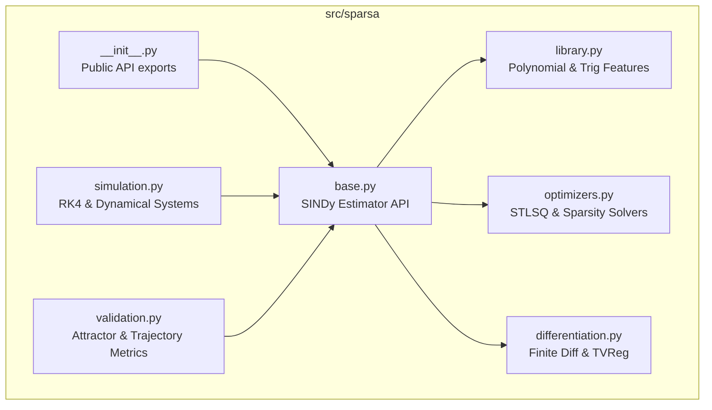
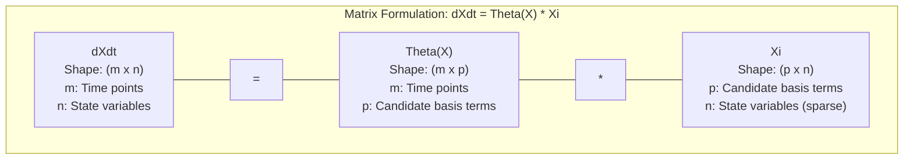
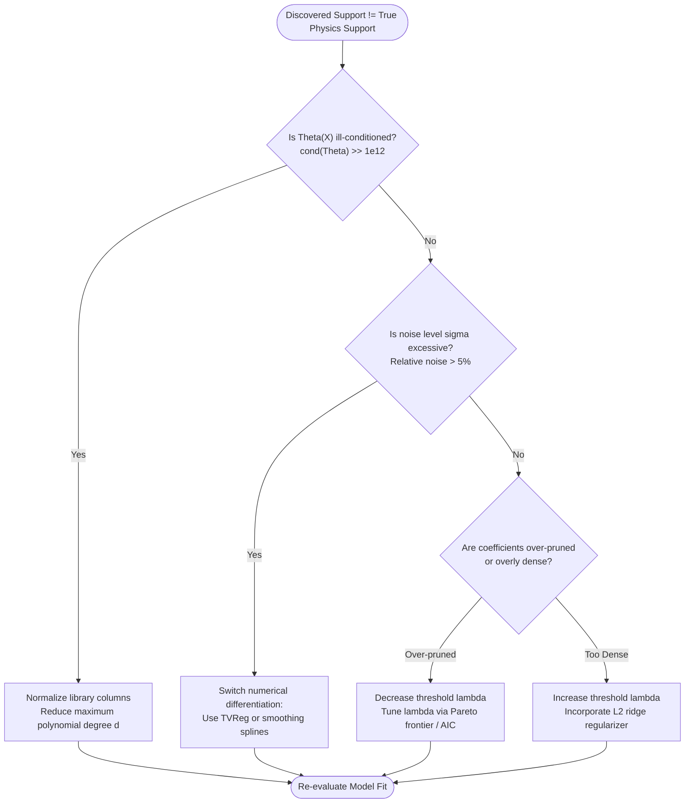

# sparsa

> A pure NumPy implementation of Sparse Identification of Nonlinear Dynamics (SINDy) that extracts parsimonious, interpretable governing differential equations directly from simulated trajectory data.

[](https://www.python.org/)
[](LICENSE)
[]()
[]()
[](https://github.com/psf/black)

---

## 1. The Problem

Physical modeling traditionally relies on forward numerical simulation. An analyst begins with known differential equations $\dot{\mathbf{x}} = \mathbf{f}(\mathbf{x})$ and integrates them forward in time from an initial state $\mathbf{x}(0)$. The trajectory is the output.

Equation discovery solves the inverse problem. We observe only trajectory measurements $\mathbf{X}$, often corrupted by sensor noise. The underlying vector field $\mathbf{f}$ is unknown. The objective is to extract the symbolic, analytical ordinary differential equations directly from data.

Black-box models like deep neural networks can interpolate observed dynamics. However, they lack mechanistic interpretability, violate physical conservation laws out of distribution, and fail to extrapolate across chaotic attractors. SINDy leverages the fact that most physical systems possess only a few active terms in their governing equations. By casting discovery as a sparse regression problem across candidate nonlinear functions, SINDy recovers exact symbolic physics without combinatorial search.

---

## 2. Key Mathematical Idea

Consider a continuous-time dynamical system with state vector $\mathbf{x}(t) \in \mathbb{R}^n$:

$$
\frac{d}{dt}\mathbf{x}(t) = \mathbf{f}(\mathbf{x}(t))
$$

Given $m$ temporal snapshots sampled at times $t_1, t_2, \dots, t_m$, we assemble the state measurement matrix $\mathbf{X} \in \mathbb{R}^{m \times n}$:

$$
\mathbf{X} = \begin{bmatrix}
x_1(t_1) & x_2(t_1) & \cdots & x_n(t_1) \\
x_1(t_2) & x_2(t_2) & \cdots & x_n(t_2) \\
\vdots & \vdots & \ddots & \vdots \\
x_1(t_m) & x_2(t_m) & \cdots & x_n(t_m)
\end{bmatrix}
$$

The corresponding time-derivative matrix $\dot{\mathbf{X}} \in \mathbb{R}^{m \times n}$ is computed or numerically approximated:

$$
\dot{\mathbf{X}} = \begin{bmatrix}
\dot{x}_1(t_1) & \dot{x}_2(t_1) & \cdots & \dot{x}_n(t_1) \\
\dot{x}_1(t_2) & \dot{x}_2(t_2) & \cdots & \dot{x}_n(t_2) \\
\vdots & \vdots & \ddots & \vdots \\
\dot{x}_1(t_m) & \dot{x}_2(t_m) & \cdots & \dot{x}_n(t_m)
\end{bmatrix}
$$

We construct an extensive candidate library $\mathbf{\Theta}(\mathbf{X}) \in \mathbb{R}^{m \times p}$ consisting of constant, polynomial, and trigonometric basis functions evaluated on $\mathbf{X}$:

$$
\mathbf{\Theta}(\mathbf{X}) = \begin{bmatrix}
\mathbf{1} & \mathbf{X} & \mathbf{X}^{P_2} & \mathbf{X}^{P_3} & \cdots & \sin(\mathbf{X}) & \cos(\mathbf{X})
\end{bmatrix}
$$

The nonlinear dynamics are expressed as an overdetermined linear system:

$$
\dot{\mathbf{X}} = \mathbf{\Theta}(\mathbf{X}) \mathbf{\Xi}
$$

Here, $\mathbf{\Xi} = \begin{bmatrix} \boldsymbol{\xi}_1 & \boldsymbol{\xi}_2 & \cdots & \boldsymbol{\xi}_n \end{bmatrix} \in \mathbb{R}^{p \times n}$ is the coefficient matrix. Each column $\boldsymbol{\xi}_k$ determines the active terms governing the derivative $\dot{x}_k$.

Because physical equations are parsimonious, $\mathbf{\Xi}$ is sparse. We solve for $\mathbf{\Xi}$ using Sequentially Thresholded Least Squares (STLSQ), alternating between unconstrained least-squares regression and hard thresholding until the active support converges.

---

## 3. Architecture and Algorithms

### A. End-to-End Pipeline

```mermaid
flowchart LR
    ODE["True Dynamical System<br/>dx/dt = f(x)"] --> RK4["RK4 Forward Integrator<br/>Step size dt, steps m"]
    RK4 --> Clean["Clean Trajectory Matrix<br/>X_clean in R^(m x n)"]
    Clean --> Noise["Additive Gaussian Noise<br/>eta ~ N(0, sigma^2 I)"]
    Noise --> Noisy["Observed Trajectory<br/>X in R^(m x n)"]
    Noisy --> Diff["Numerical Differentiation<br/>Finite Diff / TVRegSpline"]
    Diff --> Deriv["Estimated Derivative Matrix<br/>dXdt in R^(m x n)"]
    Noisy --> Lib["Polynomial Library Theta(X)<br/>Degree d <= p"]
    Lib --> Theta["Candidate Feature Matrix<br/>Theta(X) in R^(m x p)"]
    Theta --> STLSQ["STLSQ Sparse Regression<br/>Threshold lambda"]
    Deriv --> STLSQ
    STLSQ --> Xi["Sparse Coefficient Matrix<br/>Xi in R^(p x n)"]
    Xi --> Model["Discovered Governing ODE<br/>dx/dt = Theta(x) * Xi"]
    Model --> Val["Validation & Attractor Reconstruction<br/>Lyapunov exponents, forecast MSE"]
```



This pipeline traces the progression from synthetic dynamical simulation to model validation. Numerical differentiation and candidate library expansion convert nonlinear equation discovery into a sparse linear regression problem.

---

### B. Sequentially Thresholded Least Squares (STLSQ)


Sequentially Thresholded Least Squares iteratively solves a standard least-squares problem and eliminates coefficients below a threshold lambda. The procedure terminates when the active support set remains invariant across successive iterations.

---

### C. Module and Dependency Layout



The codebase maintains strict separation between simulation, feature generation, numerical differentiation, and optimization. Every core sub-package communicates through the clean estimator interface defined in `base.py`.

---

### D. Data-Shape Dimensions



The system maps $m$ temporal snapshots across $n$ state variables through a candidate basis of dimension $p$. Matrix multiplication between feature matrix $\mathbf{\Theta}$ and sparse matrix $\mathbf{\Xi}$ recovers the derivative matrix $\dot{\mathbf{X}}$.

---

### E. Experiment Decision Framework



This decision logic isolates root causes when discovered model support deviates from true physics. Systematic evaluation of matrix conditioning, noise magnitude, differentiation methods, and threshold values restores exact parameter recovery.

---

## 4. Lorenz System Benchmark

The Lorenz (1963) system serves as the primary benchmark. It is a three-dimensional continuous system exhibiting deterministic chaos:

$$
\begin{aligned}
\frac{dx}{dt} &= \sigma (y - x) \\
\frac{dy}{dt} &= x (\rho - z) - y \\
\frac{dz}{dt} &= x y - \beta z
\end{aligned}
$$

Standard parameter values: $\sigma = 10$, $\rho = 28$, $\beta = 8/3 \approx 2.6667$.

Using a second-order polynomial library $\mathbf{\Theta}(\mathbf{x}) = [1, x, y, z, x^2, xy, xz, y^2, yz, z^2]$ ($p = 10$), the exact expanded equations are:

$$
\begin{aligned}
\dot{x} &= -10 x + 10 y \\
\dot{y} &= 28 x - y - x z \\
\dot{z} &= -2.6667 z + x y
\end{aligned}
$$

### Parameter Recovery Verification

| Term | True $\dot{x}$ | Discovered $\dot{x}$ | True $\dot{y}$ | Discovered $\dot{y}$ | True $\dot{z}$ | Discovered $\dot{z}$ | Abs Error (Max) | Status |
| :--- | :---: | :---: | :---: | :---: | :---: | :---: | :---: | :---: |
| $1$ | $0.0000$ | `[Pending]` | $0.0000$ | `[Pending]` | $0.0000$ | `[Pending]` | `[Pending]` | `[Pending]` |
| $x$ | $-10.0000$ | `[Pending]` | $28.0000$ | `[Pending]` | $0.0000$ | `[Pending]` | `[Pending]` | `[Pending]` |
| $y$ | $10.0000$ | `[Pending]` | $-1.0000$ | `[Pending]` | $0.0000$ | `[Pending]` | `[Pending]` | `[Pending]` |
| $z$ | $0.0000$ | `[Pending]` | $0.0000$ | `[Pending]` | $-2.6667$ | `[Pending]` | `[Pending]` | `[Pending]` |
| $x^2$ | $0.0000$ | `[Pending]` | $0.0000$ | `[Pending]` | $0.0000$ | `[Pending]` | `[Pending]` | `[Pending]` |
| $xy$ | $0.0000$ | `[Pending]` | $0.0000$ | `[Pending]` | $1.0000$ | `[Pending]` | `[Pending]` | `[Pending]` |
| $xz$ | $0.0000$ | `[Pending]` | $-1.0000$ | `[Pending]` | $0.0000$ | `[Pending]` | `[Pending]` | `[Pending]` |
| $y^2$ | $0.0000$ | `[Pending]` | $0.0000$ | `[Pending]` | $0.0000$ | `[Pending]` | `[Pending]` | `[Pending]` |
| $yz$ | $0.0000$ | `[Pending]` | $0.0000$ | `[Pending]` | $0.0000$ | `[Pending]` | `[Pending]` | `[Pending]` |
| $z^2$ | $0.0000$ | `[Pending]` | $0.0000$ | `[Pending]` | $0.0000$ | `[Pending]` | `[Pending]` | `[Pending]` |

---

## 5. Repository Structure

```
sparsa/
├── README.md
├── pyproject.toml
├── requirements.txt
├── docs/
│   └── diagrams/
│       ├── pipeline.mmd
│       ├── stlsq.mmd
│       ├── modules.mmd
│       ├── shapes.mmd
│       └── decision.mmd
├── src/
│   └── sparsa/
│       ├── __init__.py
│       ├── base.py
│       ├── differentiation.py
│       ├── library.py
│       ├── optimizers.py
│       ├── simulation.py
│       └── validation.py
├── experiments/
│   ├── lorenz_recovery.py
│   ├── noise_sweep.py
│   └── lambda_pareto.py
└── tests/
    ├── test_differentiation.py
    ├── test_library.py
    ├── test_optimizers.py
    └── test_simulation.py
```

---

## 6. Implementation Roadmap

- [ ] **Phase 1**: Mathematical formulation, library design, and architectural specification.
- [ ] **Phase 2**: High-order forward numerical integrator (vectorized RK4) in pure NumPy.
- [ ] **Phase 3**: Numerical differentiation suite (finite difference, central difference, TVReg).
- [ ] **Phase 4**: Polynomial and candidate feature matrix builder with combinatorial cross-terms.
- [ ] **Phase 5**: Sequentially Thresholded Least Squares (STLSQ) optimizer with convergence criteria.
- [ ] **Phase 6**: Core `SINDy` estimator implementing standard `.fit()`, `.predict()`, and `.score()`.
- [ ] **Phase 7**: Lorenz-63 parameter recovery benchmark on clean trajectory data.
- [ ] **Phase 8**: Noise sensitivity analysis and Pareto frontier threshold tuning ($\lambda \times \sigma$).
- [ ] **Phase 9**: Long-term trajectory forecasting, phase portrait reconstruction, and attractor metrics.
- [ ] **Phase 10**: Unit test coverage, automated benchmarks, and packaging.

---

## 7. How to Run

### Installation

Clone the repository and install required runtime dependencies:

```bash
git clone https://github.com/your-username/sparsa.git
cd sparsa
python -m venv .venv
source .venv/bin/activate
pip install numpy matplotlib
```

### Quickstart Execution

```bash
# Execute Lorenz benchmark discovery
python -m experiments.lorenz_recovery --noise 0.0 --threshold 0.1

# Execute noise sensitivity sweep
python -m experiments.noise_sweep --max-noise 0.05 --steps 20
```

---

## 8. Experimental Results Placeholder

Execution outputs, recovered coefficients, Pareto curves, and phase portrait reconstructions will be recorded below upon solver validation.

```
================ SPARSA DISCOVERY REPORT ================
Dynamical System: Lorenz-63
Integration: RK4 (dt = 0.001, t_end = 50.0, m = 50000)
Noise Level: 0.00%
Library Terms: 10 (Degree <= 2)
STLSQ Threshold (lambda): 0.1000
Iterations to Converge: [Pending]
Coefficient Error Norm: [Pending]
Support Recovery Rate: [Pending] / 100%
========================================================
```

---

## 9. References

1. Brunton, S. L., Proctor, J. L., & Kutz, J. N. (2016). *Discovering governing equations from data by sparse identification of nonlinear dynamical systems*. **Proceedings of the National Academy of Sciences (PNAS)**, 113(15), 3932-3937. [doi:10.1073/pnas.1517384113](https://doi.org/10.1073/pnas.1517384113)
2. Lorenz, E. N. (1963). *Deterministic nonperiodic flow*. **Journal of the Atmospheric Sciences**, 20(2), 130-141.

