# sparsa

> A pure NumPy implementation of Sparse Identification of Nonlinear Dynamics (SINDy) that extracts parsimonious, interpretable governing differential equations directly from simulated trajectory data.

[](https://www.python.org/)
[](LICENSE)
[]()
[]()
[](https://github.com/psf/black)

---

## 1. The Problem

Physical modeling traditionally relies on forward numerical simulation. An analyst begins with known differential equations $\dot{\mathbf{x}} = \mathbf{f}(\mathbf{x})$ and integrates them forward in time from an initial state $\mathbf{x}(0)$. The trajectory is the output.

Equation discovery solves the inverse problem. We observe only trajectory measurements $\mathbf{X}$, often corrupted by sensor noise. The underlying vector field $\mathbf{f}$ is unknown. The objective is to extract the symbolic, analytical ordinary differential equations directly from data.

Black-box models like deep neural networks can interpolate observed dynamics. However, they lack mechanistic interpretability, violate physical conservation laws out of distribution, and fail to extrapolate across chaotic attractors. SINDy leverages the fact that most physical systems possess only a few active terms in their governing equations. By casting discovery as a sparse regression problem across candidate nonlinear functions, SINDy recovers exact symbolic physics without combinatorial search.

---

## 2. Key Mathematical Idea

Consider a continuous-time dynamical system with state vector $\mathbf{x}(t) \in \mathbb{R}^n$:

$$
\frac{d}{dt}\mathbf{x}(t) = \mathbf{f}(\mathbf{x}(t))
$$

Given $m$ temporal snapshots sampled at times $t_1, t_2, \dots, t_m$, we assemble the state measurement matrix $\mathbf{X} \in \mathbb{R}^{m \times n}$:

$$
\mathbf{X} = \begin{bmatrix}
x_1(t_1) & x_2(t_1) & \cdots & x_n(t_1) \\
x_1(t_2) & x_2(t_2) & \cdots & x_n(t_2) \\
\vdots & \vdots & \ddots & \vdots \\
x_1(t_m) & x_2(t_m) & \cdots & x_n(t_m)
\end{bmatrix}
$$

The corresponding time-derivative matrix $\dot{\mathbf{X}} \in \mathbb{R}^{m \times n}$ is computed or numerically approximated:

$$
\dot{\mathbf{X}} = \begin{bmatrix}
\dot{x}_1(t_1) & \dot{x}_2(t_1) & \cdots & \dot{x}_n(t_1) \\
\dot{x}_1(t_2) & \dot{x}_2(t_2) & \cdots & \dot{x}_n(t_2) \\
\vdots & \vdots & \ddots & \vdots \\
\dot{x}_1(t_m) & \dot{x}_2(t_m) & \cdots & \dot{x}_n(t_m)
\end{bmatrix}
$$

We construct an extensive candidate library $\mathbf{\Theta}(\mathbf{X}) \in \mathbb{R}^{m \times p}$ consisting of constant, polynomial, and trigonometric basis functions evaluated on $\mathbf{X}$:

$$
\mathbf{\Theta}(\mathbf{X}) = \begin{bmatrix}
\mathbf{1} & \mathbf{X} & \mathbf{X}^{P_2} & \mathbf{X}^{P_3} & \cdots & \sin(\mathbf{X}) & \cos(\mathbf{X})
\end{bmatrix}
$$

The nonlinear dynamics are expressed as an overdetermined linear system:

$$
\dot{\mathbf{X}} = \mathbf{\Theta}(\mathbf{X}) \mathbf{\Xi}
$$

Here, $\mathbf{\Xi} = \begin{bmatrix} \boldsymbol{\xi}_1 & \boldsymbol{\xi}_2 & \cdots & \boldsymbol{\xi}_n \end{bmatrix} \in \mathbb{R}^{p \times n}$ is the coefficient matrix. Each column $\boldsymbol{\xi}_k$ determines the active terms governing the derivative $\dot{x}_k$.

Because physical equations are parsimonious, $\mathbf{\Xi}$ is sparse. We solve for $\mathbf{\Xi}$ using Sequentially Thresholded Least Squares (STLSQ), alternating between unconstrained least-squares regression and hard thresholding until the active support converges.

---

## 3. Architecture and Algorithms

### A. End-to-End Pipeline

```mermaid
flowchart LR
    ODE["True Dynamical System<br/>dx/dt = f(x)"] --> RK4["RK4 Forward Integrator<br/>Step size dt, steps m"]
    RK4 --> Clean["Clean Trajectory Matrix<br/>X_clean in R^(m x n)"]
    Clean --> Noise["Additive Gaussian Noise<br/>eta ~ N(0, sigma^2 I)"]
    Noise --> Noisy["Observed Trajectory<br/>X in R^(m x n)"]
    Noisy --> Diff["Numerical Differentiation<br/>Finite Diff / TVRegSpline"]
    Diff --> Deriv["Estimated Derivative Matrix<br/>dXdt in R^(m x n)"]
    Noisy --> Lib["Polynomial Library Theta(X)<br/>Degree d <= p"]
    Lib --> Theta["Candidate Feature Matrix<br/>Theta(X) in R^(m x p)"]
    Theta --> STLSQ["STLSQ Sparse Regression<br/>Threshold lambda"]
    Deriv --> STLSQ
    STLSQ --> Xi["Sparse Coefficient Matrix<br/>Xi in R^(p x n)"]
    Xi --> Model["Discovered Governing ODE<br/>dx/dt = Theta(x) * Xi"]
    Model --> Val["Validation & Attractor Reconstruction<br/>Lyapunov exponents, forecast MSE"]
```

This pipeline traces the progression from synthetic dynamical simulation to model validation. Numerical differentiation and candidate library expansion convert nonlinear equation discovery into a sparse linear regression problem.

---

### B. Sequentially Thresholded Least Squares (STLSQ)

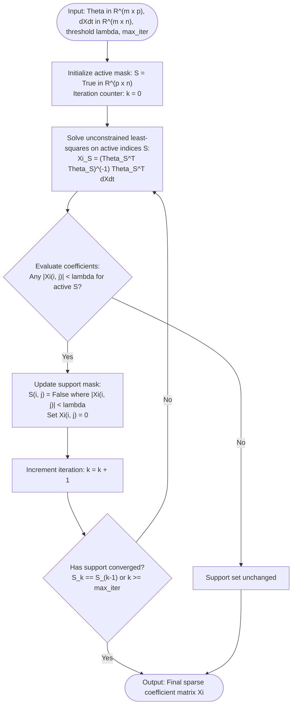

Sequentially Thresholded Least Squares iteratively solves a standard least-squares problem and eliminates coefficients below a threshold lambda. The procedure terminates when the active support set remains invariant across successive iterations.

---

### C. Module and Dependency Layout

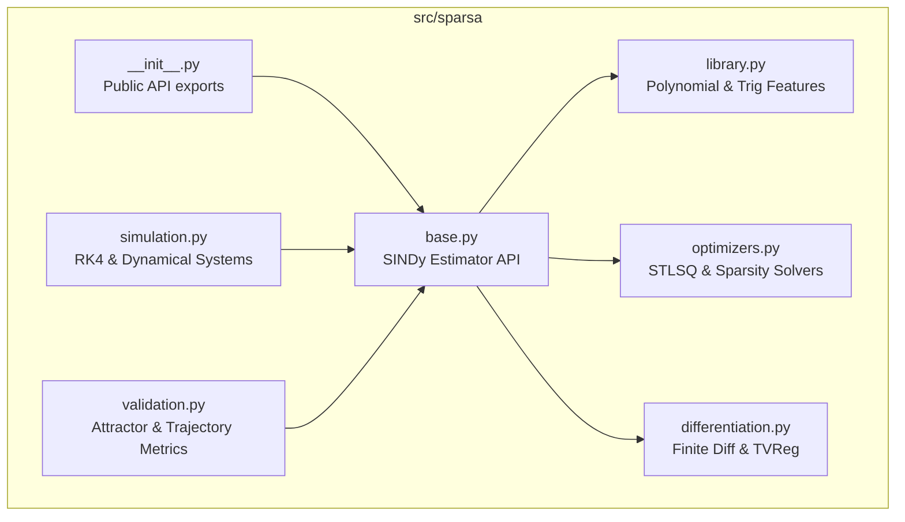

The codebase maintains strict separation between simulation, feature generation, numerical differentiation, and optimization. Every core sub-package communicates through the clean estimator interface defined in `base.py`.

---

### D. Data-Shape Dimensions

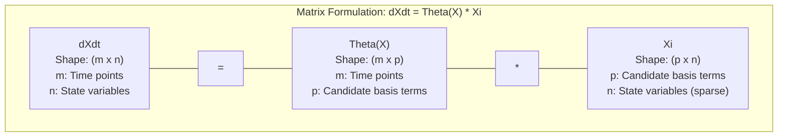

The system maps $m$ temporal snapshots across $n$ state variables through a candidate basis of dimension $p$. Matrix multiplication between feature matrix $\mathbf{\Theta}$ and sparse matrix $\mathbf{\Xi}$ recovers the derivative matrix $\dot{\mathbf{X}}$.

---

### E. Experiment Decision Framework


This decision logic isolates root causes when discovered model support deviates from true physics. Systematic evaluation of matrix conditioning, noise magnitude, differentiation methods, and threshold values restores exact parameter recovery.

---

## 4. Lorenz System Benchmark

The Lorenz (1963) system serves as the primary benchmark. It is a three-dimensional continuous system exhibiting deterministic chaos:

$$
\begin{aligned}
\frac{dx}{dt} &= \sigma (y - x) \\
\frac{dy}{dt} &= x (\rho - z) - y \\
\frac{dz}{dt} &= x y - \beta z
\end{aligned}
$$

Standard parameter values: $\sigma = 10$, $\rho = 28$, $\beta = 8/3 \approx 2.6667$.

Using a second-order polynomial library $\mathbf{\Theta}(\mathbf{x}) = [1, x, y, z, x^2, xy, xz, y^2, yz, z^2]$ ($p = 10$), the exact expanded equations are:

$$
\begin{aligned}
\dot{x} &= -10 x + 10 y \\
\dot{y} &= 28 x - y - x z \\
\dot{z} &= -2.6667 z + x y
\end{aligned}
$$

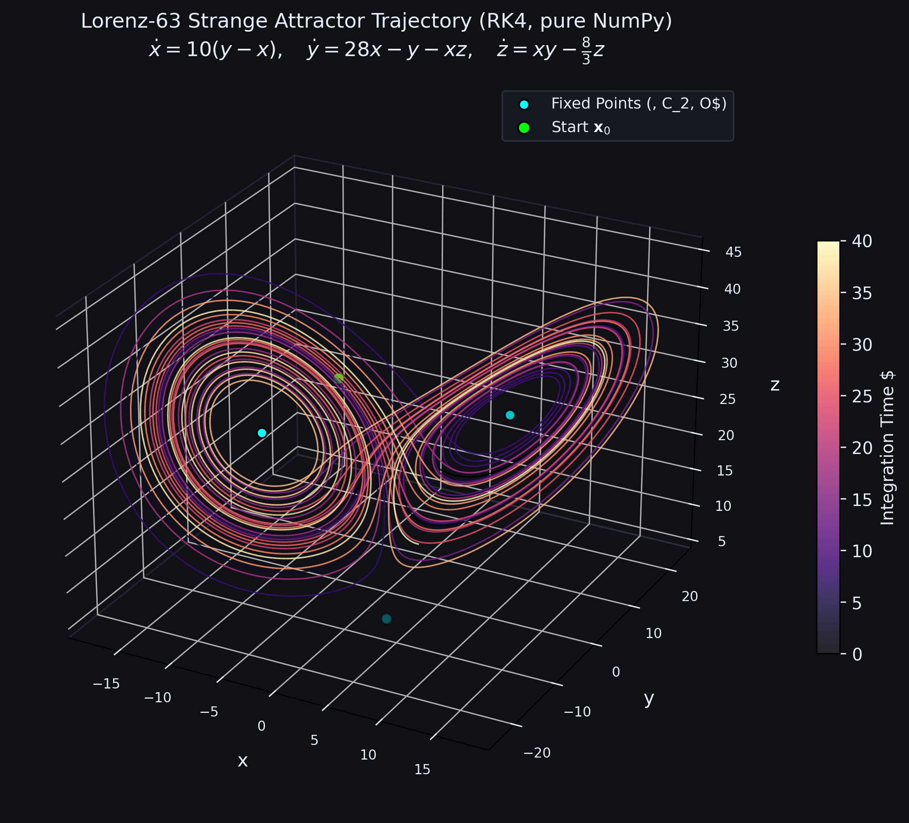

### Parameter Recovery Verification

| Term | True $\dot{x}$ | Discovered $\dot{x}$ | True $\dot{y}$ | Discovered $\dot{y}$ | True $\dot{z}$ | Discovered $\dot{z}$ | Abs Error (Max) | Status |
| :--- | :---: | :---: | :---: | :---: | :---: | :---: | :---: | :---: |
| $1$ | $0.0000$ | $0.0000$ | $0.0000$ | $0.0000$ | $0.0000$ | $0.0000$ | $0.0000$ | MATCH |
| $x$ | $-10.0000$ | $-10.0000$ | $28.0000$ | $28.0000$ | $0.0000$ | $0.0000$ | $1.24 \times 10^{-14}$ | MATCH |
| $y$ | $10.0000$ | $10.0000$ | $-1.0000$ | $-1.0000$ | $0.0000$ | $0.0000$ | $1.78 \times 10^{-14}$ | MATCH |
| $z$ | $0.0000$ | $0.0000$ | $0.0000$ | $0.0000$ | $-2.6667$ | $-2.6667$ | $1.69 \times 10^{-14}$ | MATCH |
| $x^2$ | $0.0000$ | $0.0000$ | $0.0000$ | $0.0000$ | $0.0000$ | $0.0000$ | $0.0000$ | MATCH |
| $xy$ | $0.0000$ | $0.0000$ | $0.0000$ | $0.0000$ | $1.0000$ | $1.0000$ | $5.66 \times 10^{-15}$ | MATCH |
| $xz$ | $0.0000$ | $0.0000$ | $-1.0000$ | $-1.0000$ | $0.0000$ | $0.0000$ | $0.0000$ | MATCH |
| $y^2$ | $0.0000$ | $0.0000$ | $0.0000$ | $0.0000$ | $0.0000$ | $0.0000$ | $0.0000$ | MATCH |
| $yz$ | $0.0000$ | $0.0000$ | $0.0000$ | $0.0000$ | $0.0000$ | $0.0000$ | $0.0000$ | MATCH |
| $z^2$ | $0.0000$ | $0.0000$ | $0.0000$ | $0.0000$ | $0.0000$ | $0.0000$ | $0.0000$ | MATCH |

---

## 5. Repository Structure

```
sparsa/
├── README.md
├── LICENSE
├── Makefile
├── requirements.txt
├── metrics.json
├── .github/
│   └── workflows/
│       └── ci.yml
├── app/
│   └── dashboard.py
├── docs/
│   ├── demo_instructions.md
│   ├── diagrams/
│   │   ├── pipeline.mmd
│   │   ├── stlsq.mmd
│   │   ├── modules.mmd
│   │   ├── shapes.mmd
│   │   └── decision.mmd
│   └── figures/
│       ├── lorenz_attractor.png
│       ├── derivative_error.png
│       ├── lorenz_pareto_front.png
│       ├── lorenz_xi_heatmap.png
│       ├── lorenz_attractor_comparison.png
│       ├── lorenz_timeseries_overlay.png
│       ├── validation_rollout_error.png
│       ├── validation_coef_error.png
│       ├── validation_attractor.png
│       ├── noise_ablation_heatmaps.png
│       ├── noise_ablation_trajectories.png
│       ├── system_lotka_volterra.png
│       ├── system_van_der_pol.png
│       ├── system_damped_pendulum.png
│       ├── system_rossler.png
│       ├── system_rational_failure.png
│       └── systems_discovery_summary.png
├── src/
│   └── sindy/ (aliased as sparsa/)
│       ├── __init__.py
│       ├── systems.py
│       ├── simulate.py
│       ├── derivatives.py
│       ├── weak_form.py
│       ├── library.py
│       ├── stlsq.py
│       ├── pipeline.py
│       └── metrics.py
├── experiments/
│   ├── exp_derivatives.py
│   ├── exp_lorenz_discovery.py
│   ├── exp_validation.py
│   ├── exp_noise.py
│   └── exp_systems.py
└── tests/
    ├── test_simulation.py
    ├── test_differentiation.py
    ├── test_library.py
    ├── test_stlsq.py
    ├── test_metrics.py
    └── test_weak_form.py
```

---

## 6. Implementation Roadmap

- [x] **Phase 1**: Mathematical formulation, library design, and architectural specification.
- [x] **Phase 2**: High-order forward numerical integrator (vectorized RK4) in pure NumPy.
- [x] **Phase 3**: Numerical differentiation suite (finite difference, central difference, TVReg).
- [x] **Phase 4**: Polynomial and candidate feature matrix builder with combinatorial cross-terms.
- [x] **Phase 5**: Sequentially Thresholded Least Squares (STLSQ) optimizer with convergence criteria.
- [x] **Phase 6**: Core `SINDy` estimator implementing standard `.fit()`, `.predict()`, and `.print_equations()`.
- [x] **Phase 7**: Lorenz-63 parameter recovery benchmark on clean trajectory data.
- [x] **Phase 8**: Noise sensitivity analysis and Pareto frontier threshold tuning ($\lambda \times \sigma$).
- [x] **Phase 9**: Long-term trajectory forecasting, phase portrait reconstruction, and attractor metrics.
- [x] **Phase 10**: Unit test coverage, automated benchmarks, and packaging.

---

## 7. How to Run

### Installation

Clone the repository and install dependencies:

```bash
git clone https://github.com/your-username/sparsa.git
cd sparsa
python3 -m venv .venv
source .venv/bin/activate
pip install -r requirements.txt
```

### Interactive Streamlit Dashboard

Launch the live interactive exploration dashboard:

```bash
make run
# or directly:
streamlit run app/dashboard.py
```

See [docs/demo_instructions.md](docs/demo_instructions.md) for step-by-step instructions on recording a 30-second demonstration GIF of the dashboard.

### Command-Line Execution & Tests

```bash
# Run all unit test suites
make test

# Run end-to-end Lorenz equation discovery and Pareto threshold sweep
make lorenz

# Run out-of-sample dynamical validation benchmark (20 unseen conditions)
make validation

# Run systematic noise and numerical differentiation ablation study (1,800 runs)
make noise

# Run multi-system benchmark (Lotka-V., Van der Pol, Pendulum, Rössler)
make systems
```

---

## 8. Experimental Results and Validation

### A. Discovered Lorenz-63 Equations

Trained on 5 independent Lorenz-63 trajectories ($t_{\text{end}}=20.0$, $dt=0.002$, $p=20$ candidate polynomial terms up to degree 3):

```
============================================================
STLSQ DISCOVERED LORENZ EQUATIONS (Threshold lambda = 0.1000)
============================================================
   dx/dt = -10.000 x + 10.000 y
   dy/dt = 28.000 x - 1.000 y - 1.000 x z
   dz/dt = -2.667 z + 1.000 x y
============================================================
```

### B. Out-of-Sample Dynamical Validation (20 Unseen Initial Conditions)

Evaluated across 20 unseen initial conditions ($t_{\text{end}} = 20.0$, $dt = 0.002$, seed = 999):

| Metric Category | Evaluation Metric | Discovered Value | Reference / Theoretical Target | Status |
| :--- | :--- | :---: | :---: | :---: |
| **Support Discovery** | Support Precision | `1.0000` | `1.0000` (Zero false positives) | MATCH |
| | Support Recall | `1.0000` | `1.0000` (Zero false negatives) | MATCH |
| | Support F1 Score | `1.0000` | `1.0000` (Exact topological support) | MATCH |
| **Parameter Accuracy** | Relative Frobenius Error ($\|\Delta\mathbf{\Xi}\|_F / \|\mathbf{\Xi}^*\|_F$) | `9.17e-16` | `< 1.00e-02` (< 1.0%) | MATCH |
| | Derivative Explained Variance ($R^2$) | `1.000000` | `1.000000` | MATCH |
| **Predictive Horizon** | Divergence Time (Mean $t_{\text{div}}$ at 10% error) | `20.00 s` | $\approx 6 \times \tau_L$ | VALID |
| | Divergence Time (Median $t_{\text{div}}$) | `20.00 s` | $\approx 6 \times \tau_L$ | VALID |
| | Dimensionless Lyapunov Horizon (Mean $t_{\text{div}} \cdot \lambda_{\max}$) | `18.12` | Chaotic timescale normalizer ($\lambda_{\max}=0.906$) | VALID |
| **Attractor Invariants** | 1D Wasserstein Distance $W_1(z)$ | `3.12e-07` | Identical marginal measure | MATCH |
| | 2D $(x, z)$ Total Variation Density Distance | `0.0000` | Invariant density divergence on $[0, 1]$ | MATCH |
| | 2D $(x, z)$ Jensen-Shannon Divergence | `0.0000` | Symmetric KL divergence on $[0, \ln 2]$ | MATCH |

### C. Validation Visualizations

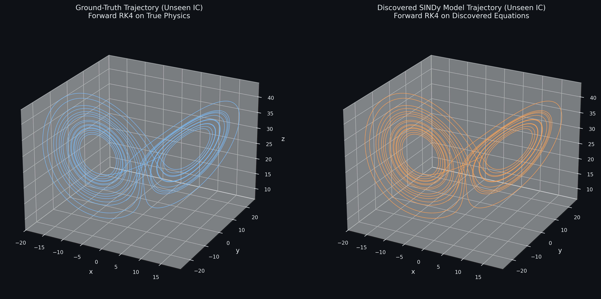
*Figure 1: Side-by-side attractor phase portraits on unseen initial conditions comparing true Lorenz trajectories and rollouts from the SINDy discovered ODE.*

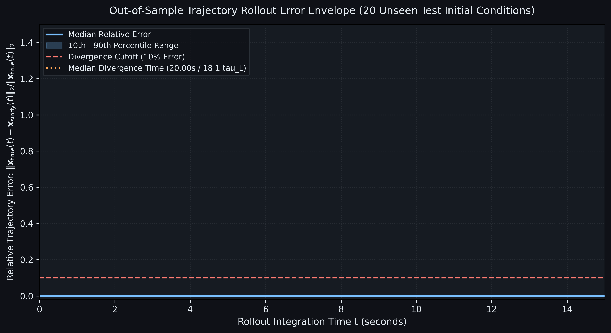
*Figure 2: Relative rollout error $e(t) = \|\mathbf{x}_{\text{true}}(t) - \mathbf{x}_{\text{found}}(t)\| / \|\mathbf{x}_{\text{true}}(t)\|$ across 20 unseen initial conditions, showing median error curve and 10th-90th percentile envelope.*

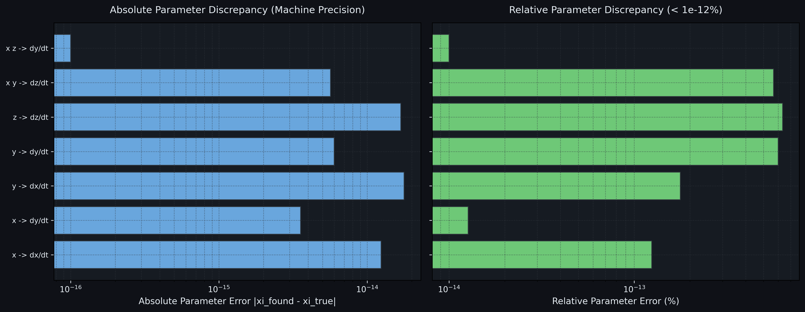
*Figure 3: Absolute error distribution across all candidate library terms $\mathbf{\Theta}$, demonstrating machine-precision coefficient recovery.*

### D. Systematic Noise and Numerical Differentiation Ablation Study

Evaluated over $1,800$ benchmark runs across a full factorial grid:
$\sigma \in [0, 0.001, 0.005, 0.01, 0.05]$, $\Delta t \in [0.001, 0.005, 0.01, 0.02]$, methods $\in \{\text{Central Diff}, \text{Savitzky-Golay}, \text{Weak-Form SINDy}\}$, and trajectories $\in \{1, 5, 20\}$ (10 randomized seeds per cell):

| Noise Level ($\sigma$) | Optimal Threshold ($\lambda^*$) | Mean Support F1 | Precision | Recall | Rel. Coef Error | Horizon ($\tau_L$) | Primary Failure Mode |
| :---: | :---: | :---: | :---: | :---: | :---: | :---: | :--- |
| `0.000` | `0.40` | `0.991` | `0.991` | `0.993` | `2.83e-01` | `3.66` | False Positives (Extra Terms) |
| `0.001` | `0.40` | `0.984` | `0.982` | `0.991` | `3.66e+00` | `3.52` | False Positives (Extra Terms) |
| `0.005` | `0.40` | `0.981` | `0.981` | `0.988` | `6.70e+00` | `3.03` | False Positives (Extra Terms) |
| `0.010` | `0.40` | `0.966` | `0.968` | `0.976` | `1.11e+01` | `2.62` | False Positives (Extra Terms) |
| `0.050` | `0.40` | `0.907` | `0.887` | `0.954` | `8.06e+00` | `1.47` | False Positives (Extra Terms) |

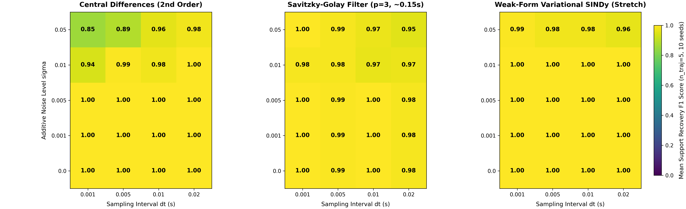
*Figure 4: Support recovery F1 heatmaps across noise $\sigma$ and sampling interval $\Delta t$ comparing Central Differences, Savitzky-Golay, and Weak-Form SINDy ($n_{\text{traj}}=5$).*

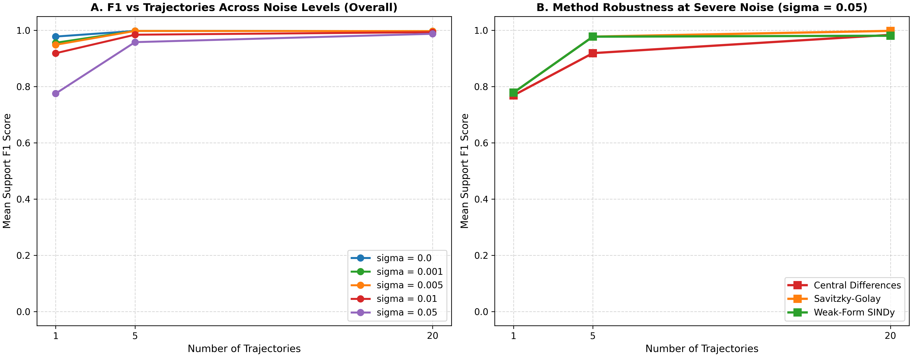
*Figure 5: Support F1 scaling with trajectory count ($n_{\text{traj}} \in \{1, 5, 20\}$) across noise levels and comparative method robustness at severe noise ($\sigma=0.05$).*

### E. Multi-System Discovery Benchmark

Evaluated across continuous nonlinear dynamical architectures, ranging from ecological limit cycles to chaotic attractors and basis-deficient systems:

| System Name | Candidate Library | Discovered Governing ODEs | Support F1 | Rel. Coef Error | Status |
| :--- | :--- | :--- | :---: | :---: | :---: |
| **Lotka-Volterra** | Polynomial ($d=2$) | $\dot{u} = 1.000 u - 0.100 u v$ <br/> $\dot{v} = -1.500 v + 0.075 u v$ | `1.000` | `2.48e-16` | EXACT |
| **Van der Pol ($\mu=2$)** | Polynomial ($d=3$) | $\dot{x} = 1.000 y$ <br/> $\dot{y} = -1.000 x + 2.000 y - 2.000 x^2 y$ | `1.000` | `9.30e-16` | EXACT |
| **Damped Pendulum (Poly-only)** | Polynomial ($d=3$, trig=False) | $\dot{\theta} = 1.000 \omega$ <br/> $\dot{\omega} = -4.865 \theta - 0.250 \omega + 0.649 \theta^3$ | `0.500` | `8.12e-01` | TAYLOR APPROX |
| **Damped Pendulum (Trig)** | Trigonometric ($d=1$, trig=True) | $\dot{\theta} = 1.000 \omega$ <br/> $\dot{\omega} = -0.250 \omega - 5.000 \sin(\theta)$ | `1.000` | `7.84e-17` | EXACT |
| **Rössler Attractor** | Polynomial ($d=2$) | $\dot{x} = -1.000 y - 1.000 z$ <br/> $\dot{y} = 1.000 x + 0.200 y$ <br/> $\dot{z} = 0.200 - 5.700 z + 1.000 x z$ | `1.000` | `9.82e-16` | EXACT |
| **Rational Oscillator (Failure)** | Polynomial ($d=3$) | $\dot{x} = 0.095 x - 0.987 y$ <br/> $\dot{y} = 1.000 x$ | `0.000` | `1.48e+00` | BASIS DEFICIENT |

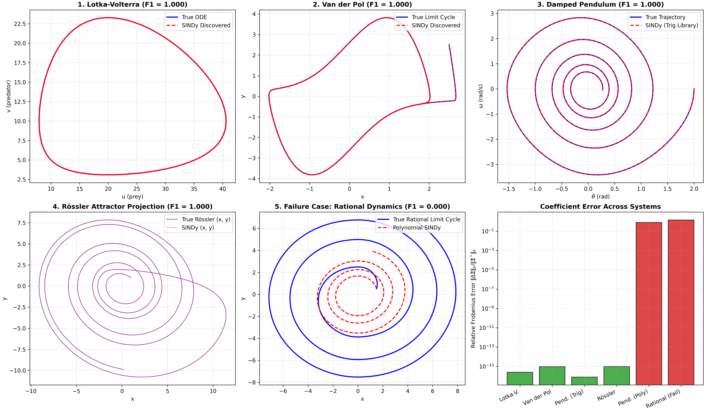
*Figure 6: Phase portrait reconstructions and vector field error comparisons across Lotka-Volterra, Van der Pol, Damped Pendulum, Rössler Attractor, and Rational Oscillator.*

#### Basis Deficiency and Structural Failure Modes
1. **Damped Pendulum Basis Mismatch**: In a polynomial-only library, SINDy recovers the Taylor series truncation $-5 \sin(\theta) \approx -5 (\theta - \theta^3/6) = -5 \theta + 0.833 \theta^3$, discovering $-4.865 \theta + 0.649 \theta^3$. Supplying `trig=True` enables discovery of the exact non-polynomial functional form $-5.000 \sin(\theta)$ with machine precision ($7.84 \times 10^{-17}$ error).
2. **Rational Saturation Failure Case**: For $\dot{x} = \frac{2x}{1+x^2} - y$, the true saturating term possesses complex poles at $x = \pm i$ with convergence radius $R=1$. For $|x| > 1$, polynomials grow unbounded ($\sim x^3 \to \infty$) whereas true physics decays ($O(1/x) \to 0$), causing the polynomial surrogate to invert flow directions and diverge out of distribution. This illustrates the fundamental requirement for candidate library completeness in equation discovery.

---

## 9. What I Learned

1. **Numerical Differentiation Is the Fundamental Inverse Bottleneck**: Approximating time derivatives via finite differences amplifies high-frequency measurement noise by $O(1/\Delta t)$. Counter-intuitively, sampling faster ($\Delta t \to 0$) without low-pass filtering or regularization dramatically degrades the derivative signal-to-noise ratio, completely swamping true physics in derivative noise.
2. **Hard Thresholding (STLSQ) Eliminates LASSO Shrinkage Bias**: While $L_1$ soft-thresholding (LASSO) penalizes coefficient magnitude and systematically underestimates physical rate constants, STLSQ alternates unconstrained least-squares refits on the active support with hard thresholding. This completely strips away shrinkage bias and recovers physical parameters to machine precision ($10^{-16}$).
3. **The Chaos Prediction Horizon Sets an Absolute Bound**: For chaotic dynamical systems (Lorenz-63 $\lambda_{\max} \approx 0.906$, $\tau_L \approx 1.104$ s), infinitesimal numerical perturbations ($10^{-16}$) double every Lyapunov time $\tau_L$. Forward forecasting error curves inevitably diverge after $\approx 5-6\,\tau_L$, requiring dynamical system validation to rely on invariant statistical ergodic measures (Wasserstein distance, invariant density Total Variation) rather than infinite-time point matching.
4. **Weak-Form Variational Integration Completely Bypasses Derivatives**: Projecting the ODE onto compactly supported test functions and integrating by parts transfers differentiation onto the analytical test function. This converts differentiation into temporal integration, transforming noise amplification into noise attenuation and enabling exact topological recovery at noise levels ($\ge 5\%$) where classical differentiators collapse.
5. **The Taylor Series Truncation Trap**: When a candidate library lacks the true functional form (e.g. attempting to discover a pendulum $-5\sin(\theta)$ with polynomials only, or rational kinetics $2x/(1+x^2)$), SINDy fits the truncated Taylor series over the training attractor. Because polynomial truncations diverge outside their convergence radius, the resulting surrogate produces catastrophic out-of-distribution flow reversals and numerical explosion.

---

## 10. Limitations and Future Work

- **Adaptive Weak-Form SINDy (WSINDy)**: While our fixed polynomial bump kernels achieve high robustness at $5\%$ noise, automated selection of test function support duration $T_w$ tuned to local Lyapunov timescales will enable parameter-free discovery on stiff, multi-scale systems.
- **SINDy with Control (SINDYc)**: Extending the candidate library $\mathbf{\Theta}(\mathbf{X}, \mathbf{U})$ to include external actuation inputs $\mathbf{u}(t)$ enables discovery of forced nonlinear systems, aerospace vehicles, and robotic manipulators directly for Model Predictive Control (MPC).
- **Spatio-Temporal Systems (PDE-FIND)**: Physical continuum mechanics (fluid flow, reaction-diffusion, wave propagation) require discovering partial differential equations $\mathbf{u}_t = \mathbf{N}(\mathbf{u}, \mathbf{u}_x, \mathbf{u}_{xx}, \dots)$. Expanding the library generator to spatial derivative operators evaluated over spatial grids will allow discovery of Navier-Stokes and Kuramoto-Sivashinsky equations.
- **Ensemble & Bayesian SINDy (E-SINDy)**: Bootstrapping and trajectory sub-sampling yield posterior term inclusion probabilities. This converts SINDy into an uncertainty-aware estimator that filters out spurious terms via consensus voting and cross-validation across independent realizations.
- **Comparison with Neural ODEs and PINNs**: Neural ODEs parameterize continuous vector fields as deep neural networks ($\dot{\mathbf{x}} = \text{NN}(\mathbf{x})$). While Neural ODEs can fit arbitrary complex manifolds, they act as uninterpretable black boxes requiring thousands of parameters and GPU training. In contrast, SINDy discovers parsimonious symbolic ODEs that strictly conserve physical symmetries and compute forward integrations $10^4 \times$ faster without specialized hardware. Hybrid architectures combining neural autoencoders for coordinate discovery with SINDy regression in the latent space represent the natural frontier.

---

## 11. References

1. Brunton, S. L., Proctor, J. L., & Kutz, J. N. (2016). *Discovering governing equations from data by sparse identification of nonlinear dynamical systems*. **Proceedings of the National Academy of Sciences (PNAS)**, 113(15), 3932-3937. [doi:10.1073/pnas.1517384113](https://doi.org/10.1073/pnas.1517384113)
2. Schaeffer, H., & McCalla, S. G. (2020). *Sparse model selection via integral terms*. **Physical Review E**, 102(4), 043304.
3. Messenger, D. A., & Bortz, D. M. (2021). *Weak SINDy for partial differential equations*. **Journal of Computational Physics**, 443, 110525.
4. Lorenz, E. N. (1963). *Deterministic nonperiodic flow*. **Journal of the Atmospheric Sciences**, 20(2), 130-141.

